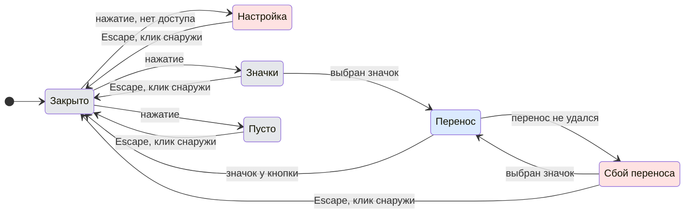

# Menu Bar Panel

## 1. Зачем и путь пользователя
На Mac с вырезом значки справа в строке меню не помещаются и пропадают за камерой. Сейчас до них нельзя добраться, не закрыв другие приложения. Menu Bar Panel показывает эти настоящие значки в панели под своей кнопкой; выбранный значок переезжает к кнопке и остаётся там. Приложение не получает объекты NSStatusItem другого процесса: оно делает снимки настоящих окон значков и переставляет выбранный значок так же, как пользователь Command-перетаскиванием.

Путь: нажать кнопку в строке меню → увидеть ряд скрытых значков в том виде, в каком они выглядят в строке меню → нажать значок → значок встаёт слева от кнопки, панель закрывается → нажать на значок в строке меню и работать с его меню. Значок остаётся на новом месте; самый левый видимый значок уходит за вырез и появится в панели.

Готовность: оба разрешения включены для этого `.app`, и в панели видны снимки. Включённый переключатель в настройках ещё не готовность: macOS может хранить его для старой подписи, поэтому панель проверяет доступ фактическими API.

Первая настройка и ежедневная работа разделены. Пока нет хотя бы одного разрешения, панель показывает один список из двух пунктов с состоянием каждого. После настройки панель становится лентой значков без заголовков; справа в ленте только «⋯» с «Обновить» и «Выйти».

Форма пути: один экран настройки. Мастер отклонён: два независимых разрешения без порядка не требуют шагов.

При первом запуске кнопка встаёт крайней справа среди status items. Дальше её место запоминает macOS, и приложение его не трогает: пользователь мог перенести кнопку сам. Через секунду после запуска и смены экранов приложение проверяет, что кнопка видна вне выреза; только если она за вырезом, кнопка пересоздаётся крайней справа, иначе до неё не добраться.

### Почему значок не возвращается сам
Первая версия после закрытия меню возвращала значок обратно за вырез. macOS принимает бросок значка только в видимую часть строки, поэтому возврат за вырез требовал переставить все значки между вырезом и видимой частью: они заметно прыгали несколько секунд, а курсор уходил с места. Пользователь отказался от возврата: выбранный значок нужен рядом, порядок остальных он меняет сам. Значок остаётся там, куда его перенесли.

### Курсор
Перетаскивание значка требует событий мыши с координатами, и macOS двигает по ним курсор. На время каждого броска (около 0,1 с) курсор скрыт и сразу после отпускания возвращается на место; Command и кнопка мыши тут же отпускаются. Пока приложение ждёт, встал ли значок (до 1,5 с на попытку, до четырёх попыток), курсор, клавиатура и мышь свободны. Первая версия держала курсор скрытым, а Command нажатым на всё время ожидания, и при неудаче Mac на несколько секунд будто зависал. Нажатие на значок за пользователя не делается: он нажимает сам.

## 2. Что добавляется
| Поверхность | Что на ней появляется | Когда |
|---|---|---|
| Строка меню | Кнопка с подписью VoiceOver «Скрытые значки строки меню» | Пока приложение запущено |
| Панель, настройка | Заголовок, два пункта с отметкой состояния, у невыполненного пункта кнопка «Открыть настройки» | Нет хотя бы одного разрешения |
| Панель, работа | Ряд снимков значков в размере строки меню, кнопка «⋯» в конце ряда | Оба разрешения есть |
| Меню «⋯» и правый клик по кнопке | «Обновить» ⌘R, «Выйти из Menu Bar Panel» ⌘Q | Всегда |
| Строка меню слева от кнопки | Выбранный значок, остаётся там | После выбора значка |

Автозапуск: при первом запуске приложение регистрирует себя в объектах входа (SMAppService) и дальше стартует вместе с Mac. Регистрация делается один раз: если пользователь выключит приложение в Настройки › Основные › Объекты входа, оно не включает себя снова.

## 3. Состояния и 7. Формулировки
| Состояние | Когда | Что видит пользователь (дословно) | Что делать |
|---|---|---|---|
| Настройка | AXIsProcessTrusted или CGPreflightScreenCaptureAccess false | Заголовок «Дайте доступ к строке меню». Пункт «Универсальный доступ»: «Чтобы переносить значки к кнопке в строке меню.» Пункт «Запись экрана»: «Чтобы показать настоящие значки. Снимки не покидают этот Mac.» Выполненный пункт: зелёная отметка и «Включено». | Нажать «Открыть настройки» у невыполненного пункта |
| Значки | Оба разрешения, есть скрытые значки | Ряд снимков, подсказка и VoiceOver: имя владельца | Нажать значок |
| Пусто | Оба разрешения, скрытых значков нет | «Все значки помещаются в строку меню» | Ничего; закрыть панель |
| Нет снимка | Снимок части значков не получен | Ряд без этих значков и строка «Не удалось показать значков: N. Обновите панель.» | «⋯» → «Обновить» |
| Сбой переноса | Перенос не удался | Панель открывается снова: ряд и строка с причиной, например «Значок исчез. Обновите панель.» | Повторить нажатие или обновить |
| Не подтверждено | macOS не поставила значок слева от кнопки за четыре попытки | Ничего: панель не открывается, ошибки нет; значок там, куда его поставила macOS, часто справа от кнопки | Открыть панель и нажать значок снова |

## 4. Переходы

| Из | Событие | В | Что видит пользователь |
|---|---|---|---|
| Закрыто | Нажатие кнопки левой кнопкой | Настройка / Значки / Пусто | Панель под кнопкой в нужном состоянии |
| Закрыто | Правый клик или Control-клик по кнопке | Меню «⋯» | «Обновить», «Выйти из Menu Bar Panel» |
| Закрыто | Повторный запуск .app из Finder | Настройка / Значки / Пусто | Панель уже работающего экземпляра; вторая кнопка не появляется, второй экземпляр завершается сам |
| Панель | Escape, повторное нажатие кнопки, клик снаружи | Закрыто | Ничего |
| Настройка | «Открыть настройки» | Настройки macOS | Нужный раздел Privacy & Security; переключатель включает только пользователь |
| Настройка | Пользователь вернулся и снова открыл панель | Настройка / Значки | Отметки обновлены по фактическому доступу, без повторного запроса |
| Настройка | Приложение стало активным, пока панель открыта, и доступ изменился | Настройка / Значки | Обновлённое состояние, сам, без пользователя |
| Значки | Нажатие значка, Return или Space на значке | Перенос | Панель закрывается, значок встаёт слева от кнопки; курсор не двигается |
| Перенос | Значок у кнопки, сам, без пользователя | Закрыто | Значок в строке меню рядом с кнопкой; дальше пользователь нажимает его сам |
| Перенос | Перенос не удался | Сбой переноса | Панель открывается снова с причиной |
| Любое | «Выйти» или ⌘Q | Выход | Ничего; значки остаются на своих местах |

## 5. Что молчит
Заголовок «Скрытые значки» в рабочем состоянии не показывается: панель под кнопкой и так понятна, заголовок только отодвигает значки. «Обновить» и «Выйти» не стоят в панели: нужны редко и спорят со значками. Процессы без status windows, Dock, фоновые опросы не показываются. Снимки на диск не пишутся. Разрешения не запрашиваются при старте. Режим `--diagnose` ничего не переносит и не восстанавливает: он только читает состояние.

## 6. Пороги и время
- Проверка переноса каждые 0,3 с, до 1,5 с: строка меню анимирует перестановку до секунды при переносе издалека; раньше успешный перенос выглядит неудачным и запускает лишний бросок.
- До четырёх точек броска на один перенос: macOS выбирает место по-разному в зависимости от того, с какой стороны тянут значок; каждая попытка проверяется по порядку значков, а не по пикселям.
- Тайм-аут доставки события 0,5 с: дольше пользователь видит зависшую панель.
- Ширина снимка не больше 160 pt: текстовые значки (часы, сеть) читаются целиком, а один широкий значок не занимает весь ряд.
- Ряд шире 640 pt прокручивается: шире панель выходит за половину экрана 13" Mac и закрывает рабочее окно.

Клавиатура: ←/→ и Tab переходят между элементами, Return и Space нажимают, Escape закрывает, ⌘R обновляет, ⌘Q выходит.

Тема панели повторяет тему строки меню, а не системную: снимки значков нарисованы под строку меню, и белый значок тёмной строки на светлой панели не виден. Параметры `--appearance=light|dark` переопределяют это для проверки.

## 8. Краевые случаи
Нет обоих разрешений: оба пункта в списке, порядок любой. Рядом с кнопкой нет места справа от выреза: «Рядом с кнопкой нет места. Переместите кнопку правее с Command-перетаскиванием.», перенос не начинается. Индикатор микрофона (AudioVideoModule) macOS держит на постоянном месте и переставляет сама; при проверке порядка он не учитывается. Пользователь держит клавишу-модификатор или кнопку мыши: «Отпустите кнопки мыши и клавиши-модификаторы, затем повторите.» После каждого переноса приложение отпускает Command и кнопку мыши в системе, даже если перенос не удался. Ошибка снимка не подменяется иконкой приложения. Два экземпляра: второй не создаёт кнопку, а просит первый открыть панель.

## 9. Чего намеренно нет
Аккаунтов, облака, изменения чужих настроек, SIP/TCC, Dock-списка и поддельных меню. Настройки скрываемой области: выбираются реальные окна, не поместившиеся справа от выреза. Отдельной кнопки «Проверить снова»: состояние проверяется при каждом открытии панели и при возвращении в приложение. Своей панели без стрелки в стиле второй строки меню: системный popover уже даёт клик снаружи, Escape и анимацию, а своя реализация повторила бы их с ошибками.

## 10. Развилки
| Вопрос | Вердикт | Причина |
|---|---|---|
| Два экрана разрешений или один список | Один список | Видно, что осталось; нет круга «проверить снова» |
| Заголовок и кнопки в рабочей панели | Убраны в «⋯» и правый клик | Панель отвечает на один вопрос: какой значок открыть |
| Тема панели: системная или строки меню | Строки меню | Снимки нарисованы под строку меню |
| Встраивание чужих NSStatusItem | Невозможно публичным API | Используются снимки окон и временный перенос, как в Ice; GPL-фрагменты в THIRD_PARTY.md |
| Прямой AXPress | Отклонён | Не гарантирует видимость меню скрытого значка |
| Возвращать значок за вырез после меню | Не возвращать | Возврат за вырез переставлял все значки между вырезом и видимой частью и двигал курсор; пользователь выбрал оставить значок у кнопки |
| Ставить кнопку крайней справа при каждом запуске | Только при первом запуске и когда кнопка за вырезом | Пользователь попросил запоминать место кнопки после того, как он её перенёс |
| Режим без переноса и переключатель для него | Удалены | Пользователь попросил убрать режим: нажатие на значок всегда переносит его к кнопке |
| Сообщать «macOS не подтвердила новое расположение значка» | Не сообщать | Пользователь просто повторяет нажатие; сообщение и повторное открытие панели мешали |
| Нажимать значок за пользователя после переноса | Не нажимать | Клик двигал курсор; значок уже виден рядом, пользователь нажимает сам |

## 11. Сверка
Кнопка, панель, разрешения, пустое состояние, выход, сохранение порядка, настоящие снимки и меню. Многомониторность и вырез требуют реального железа; программные проверки геометрии их не заменяют.
